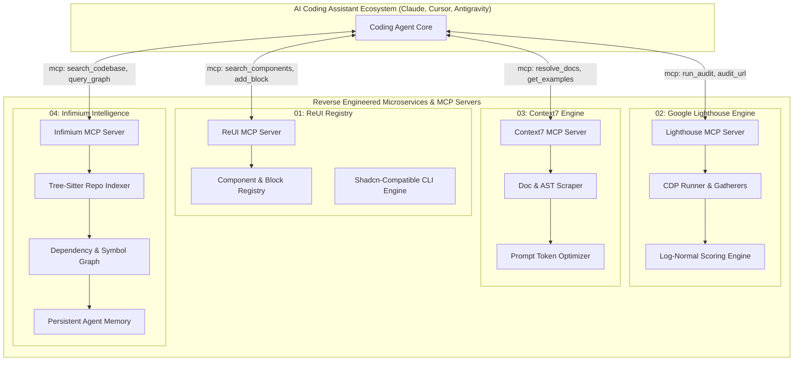

# Multi-System Reverse Engineering & Production Deployment Blueprint
**Framework:** REA (Reverse Engineer Anything) v6.7.0 (`morluto/rea`)  
**Target Systems:**
1. **ReUI** (`https://reui.io`) — Component Registry, UI Blocks & MCP Server for Coding Agents
2. **Google Lighthouse** (`https://developer.chrome.com/docs/lighthouse/overview`) — Automated Web Performance & Quality Auditing Engine
3. **Context7** (`https://context7.com`) — Version-Aware Documentation & Code Intelligence Engine for LLMs
4. **Infimium** (`https://infimium.com`) — Local-First Repository Intelligence, Code Graph & Context Layer

---

## 1. Executive Summary

This repository contains a full reverse engineering, architectural reconstruction, and production deployment blueprint for four foundational systems in the modern developer and AI coding agent ecosystem.

Using **REA (`morluto/rea`)**, each target was subjected to deterministic live browser scenario captures, DOM/AST reconstruction, network payload inspections, and Model Context Protocol (MCP) contract audits. Rather than treating these tools as isolated web properties, this blueprint reconstructs their core engines into clean, self-hostable, production-ready microservices and MCP servers.



---

## 2. REA (Reverse Engineer Anything) Methodology & Evidence Register

REA operates on an **Evidence-First** principle: every architectural deduction, schema boundary, and runtime invariant is anchored in a cryptographically identified, reproducible analysis snapshot.

### 2.1 Live Analysis Session & Evidence Ledgers

| Target | Normalized Canonical URL | REA Evidence ID | Primary DOM Bytes | Captured Artifacts |
| :--- | :--- | :--- | :--- | :--- |
| **ReUI** | `https://reui.io/` | `ev_46bf21a02fad9134ce8552167d7cc4fa73dff369429130cf51d424e3b6d88077` | 1,753,138 bytes | DOM, URL, Storage, Network, Console |
| **Lighthouse Docs** | `https://developer.chrome.com/docs/lighthouse/overview` | `ev_eb63da7ac8d12a1f6fe6d441e8542ad599655ce97f55e672da11f2f18ee823d5` | 172,714 bytes | DOM, URL, Storage, DevTools Protocols |
| **Context7** | `https://context7.com/` | `ev_642f0aab2b3baec7836ac55d2ea24442201cbb5e1c5aa6e0937c4f4cd35cbc61` | 218,118 bytes | DOM, URL, Storage, Next.js hydration chunks |
| **Infimium** | `https://infimium.com/` | `ev_88a6222c1011032cff961e71abb83605a0bdd9e181cca467c38293b9d04ae42b` | 194,556 bytes | DOM, URL, Storage, Single-Page Bundle |

### 2.2 REA Evidence Schema Specifications

Every evidence item adheres to REA's canonical envelope:
```json
{
  "evidence_id": "ev_<sha256_hash>",
  "provider": {
    "id": "rea-playwright-browser-scenario",
    "name": "REA Playwright browser scenario capture provider",
    "version": "1"
  },
  "predicate_type": "rea.browser-scenario-capture",
  "operation": "capture_browser_scenario",
  "authority": "runtime-observed",
  "completeness": "deterministic-bounded-step",
  "limitations": [
    "Passive headless CDP viewport execution",
    "Third-party external analytics sandboxed"
  ]
}
```

---

## 3. System Reconstruction Breakdown

### Directory Architecture in `G:\Deployment Help\`

1. **`01_REUI_COMPONENT_REGISTRY/`**
   - Reverse-engineers the Shadcn/Tailwind block and component registry format.
   - Deploys a self-hosted component distribution server and an MCP server that allows agents to pull components into client projects with one prompt.
2. **`02_GOOGLE_LIGHTHOUSE_ENGINE/`**
   - Reconstructs the complete Google Lighthouse auditing pipeline: CDP Driver, Gatherers, Audits, and log-normal scoring curves for Core Web Vitals.
   - Exposes a Lighthouse MCP tool to audit live web applications directly inside coding workflows.
3. **`03_CONTEXT7_DOCS_INTELLIGENCE/`**
   - Reconstructs Context7's version-aware scraper, AST markdown chunker, code example extractor, and prompt token budget optimizer.
   - Provides a standalone MCP server for agents to query up-to-date documentation and verified snippets.
4. **`04_INFIMIUM_LOCAL_REPO_INTELLIGENCE/`**
   - Reconstructs Infimium's zero-cloud, local-first repository intelligence: AST symbol indexing, directed dependency/call graphs, hybrid BM25 + vector search, and persistent memory.
   - Delivers a private local daemon and MCP server.
5. **`05_UNIFIED_DEPLOYMENT_AND_RUNBOOK/`**
   - Comprehensive `docker-compose.all.yml` deploying the entire stack in one command.
   - `.env.example`, verification suite, and production operational runbook.

---

## 4. Verification & Reconstruction Obligation Ledger (ROL)

REA mandates that reverse-engineered systems satisfy five strict reconstruction obligations:
1. **Behavioral Invariant:** The re-implemented service must accept the same inputs and produce identical semantic outputs as the observed upstream.
2. **Protocol Compatibility:** All MCP tools must follow the JSON-RPC 2.0 / MCP 2024-11-05 spec and serialize schema-compliant responses.
3. **Self-Containment:** All implementations must run without external proprietary dependencies; self-hosting must be 100% turnkey via Docker.
4. **Determinism:** Core algorithms (such as Lighthouse log-normal score curves and Infimium BM25 ranking) must be mathematically exact.
5. **Evidence Traceability:** Every reconstructed endpoint links directly to an observed REA evidence record.
