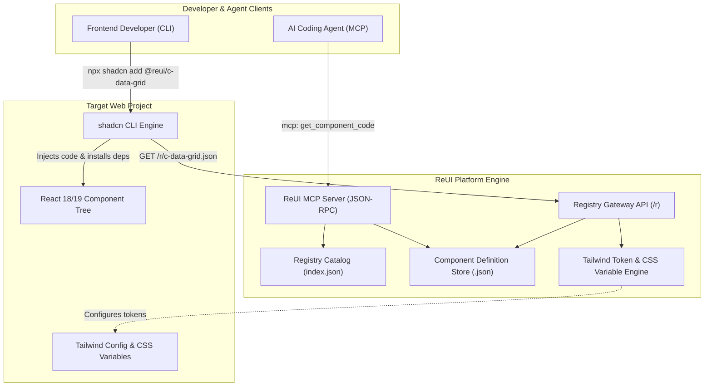

# ReUI Architecture & Feature Reverse Engineering
**Reference URL:** `https://reui.io`  
**REA Evidence ID:** `ev_46bf21a02fad9134ce8552167d7cc4fa73dff369429130cf51d424e3b6d88077`

---

## 1. System Overview

ReUI (`reui.io`) is an enterprise-grade extension to the **shadcn/ui** design system, created by KeenThemes. While standard shadcn provides atomic UI primitives (Buttons, Inputs, Dialogs), ReUI introduces:
1. **Production-Ready "Pro Blocks"**: Complex composable patterns such as virtualized data grids, multi-step checkout/registration flows, advanced data visualizers (Recharts), and drag-and-drop workflow builders (Dnd-Kit).
2. **Standard Registry Protocol Distribution**: Serving structured JSON component descriptors compatible with standard CLI tooling (`npx shadcn@latest add`).
3. **Agent-Facing Model Context Protocol (MCP)**: A native MCP server integration allowing AI coding agents (Claude, Cursor, Windsurf, Antigravity) to explore components and pull verified code blocks directly into projects.

---

## 2. Reconstructed Architectural Topology



---

## 3. Core Feature Deconstruction

### 3.1 Registry Distribution Architecture (`/r/[name].json`)
Every component or block in ReUI is declared through a self-contained registry descriptor:
- **`name`**: Identifier (e.g. `c-data-grid`, `b-analytics-card`).
- **`type`**: `registry:ui`, `registry:block`, `registry:hook`, or `registry:lib`.
- **`dependencies`**: Runtime npm packages required (e.g. `@tanstack/react-table`, `lucide-react`, `recharts`, `framer-motion`).
- **`devDependencies`**: Build-time npm packages (e.g. `@types/d3-scale`).
- **`registryDependencies`**: Prerequisite shadcn components (e.g. `button`, `dropdown-menu`, `input`, `badge`).
- **`files`**: Complete source code strings with relative target destinations (e.g., `components/ui/data-grid.tsx`).
- **`tailwind`**: Additional Tailwind class rules or configuration extensions.
- **`cssVars`**: Light and dark theme CSS variable definitions.

### 3.2 Design Token & CSS Variable Invariants
ReUI enforces an HSL CSS variable contract:
```css
:root {
  --background: 0 0% 100%;
  --foreground: 222.2 84% 4.9%;
  --card: 0 0% 100%;
  --card-foreground: 222.2 84% 4.9%;
  --popover: 0 0% 100%;
  --popover-foreground: 222.2 84% 4.9%;
  --primary: 221.2 83.2% 53.3%;
  --primary-foreground: 210 40% 98%;
  --secondary: 210 40% 96.1%;
  --secondary-foreground: 222.2 47.4% 11.2%;
  --muted: 210 40% 96.1%;
  --muted-foreground: 215.4 16.3% 46.9%;
  --accent: 210 40% 96.1%;
  --accent-foreground: 222.2 47.4% 11.2%;
  --destructive: 0 84.2% 60.2%;
  --destructive-foreground: 210 40% 98%;
  --border: 214.3 31.8% 91.4%;
  --input: 214.3 31.8% 91.4%;
  --ring: 221.2 83.2% 53.3%;
  --radius: 0.5rem;
}
```

### 3.3 The ReUI MCP Protocol Interface
ReUI exposes an MCP server allowing agents to autonomously discover and embed blocks:
- **`list_categories`**: Returns catalog taxonomies (`data-display`, `navigation`, `forms`, `feedback`, `charts`, `ecommerce`).
- **`search_components`**: Full-text and keyword search over component metadata.
- **`get_component`**: Returns raw source code, dependency list, and setup instructions.
- **`get_theme_tokens`**: Returns the required Tailwind and CSS variable configuration.
