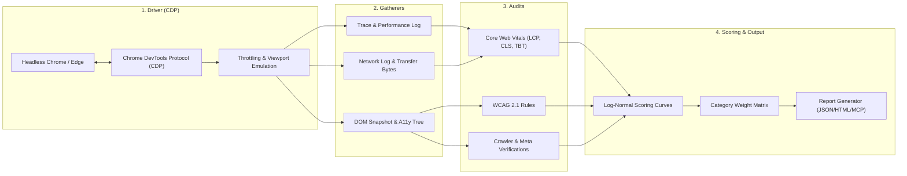

# Google Lighthouse Architecture & Feature Reverse Engineering
**Reference URL:** `https://developer.chrome.com/docs/lighthouse/overview`  
**REA Evidence ID:** `ev_eb63da7ac8d12a1f6fe6d441e8542ad599655ce97f55e672da11f2f18ee823d5`

---

## 1. System Overview

Google Lighthouse is the web industry standard automated auditing and benchmarking tool for measuring web page quality. It covers:
1. **Performance**: Measures page load, interactivity, and visual stability (Core Web Vitals).
2. **Accessibility**: Audits WCAG 2.1 contrast, ARIA landmarks, form labels, and focus order.
3. **Best Practices**: Detects modern web safety (HTTPS, CSP, unminified resources, console errors).
4. **SEO**: Checks meta tags, crawler discoverability, mobile viewport, structured data, and status codes.
5. **Progressive Web App (PWA)**: Verifies service workers, manifests, and offline capability.

---

## 2. Reconstructed Engine Pipeline

Lighthouse follows a decoupled 4-stage pipeline: **Driver $\to$ Gatherers $\to$ Audits $\to$ Scoring & Reporting**.

---

## 3. Mathematical Log-Normal Scoring Curves

Lighthouse scores raw timing metrics using the cumulative distribution function (CDF) of a log-normal distribution. Scores are strictly non-linear to reflect human perception.

Given a raw metric value $x$:
$$S(x) = 1 - \frac{1}{2} \left[ 1 + \text{erf}\left( \frac{\ln(x) - \mu}{\sigma \sqrt{2}} \right) \right] = \frac{1}{2} \text{erfc}\left( \frac{\ln(x) - \mu}{\sigma \sqrt{2}} \right)$$

Where $\mu$ and $\sigma$ are calculated from empirical target percentiles (typically $median$ at $S=0.50$ and $p_{10}$ at $S=0.90$):
$$\mu = \ln(\text{median})$$
$$\sigma = \frac{\ln(p_{10}) - \ln(\text{median})}{-1.2815515655}$$

### Metric Calibrations & Category Weights (Lighthouse v10/v11/v12)

| Metric | Short Name | Weight in Perf Score | Good (p10 / Score 0.90) | Needs Improvement (Median / 0.50) |
| :--- | :--- | :--- | :--- | :--- |
| **First Contentful Paint** | FCP | 10% | 1,800 ms | 3,000 ms |
| **Speed Index** | SI | 10% | 3,387 ms | 5,800 ms |
| **Largest Contentful Paint** | LCP | 25% | 2,500 ms | 4,000 ms |
| **Total Blocking Time** | TBT | 30% | 200 ms | 600 ms |
| **Cumulative Layout Shift** | CLS | 25% | 0.10 | 0.25 |

---

## 4. Emulation & Throttling Invariants

Default Mobile Audit Profile:
- **Device Emulation**: Viewport 412x823px, DPR 1.75, Mobile User Agent.
- **CPU Throttling**: 4x CPU slowdown (simulating mid-tier mobile hardware).
- **Network Throttling**:
  - Request Latency: 150 ms
  - Download Throughput: 1,638.4 Kbps (1.6 Mbps)
  - Upload Throughput: 750 Kbps
