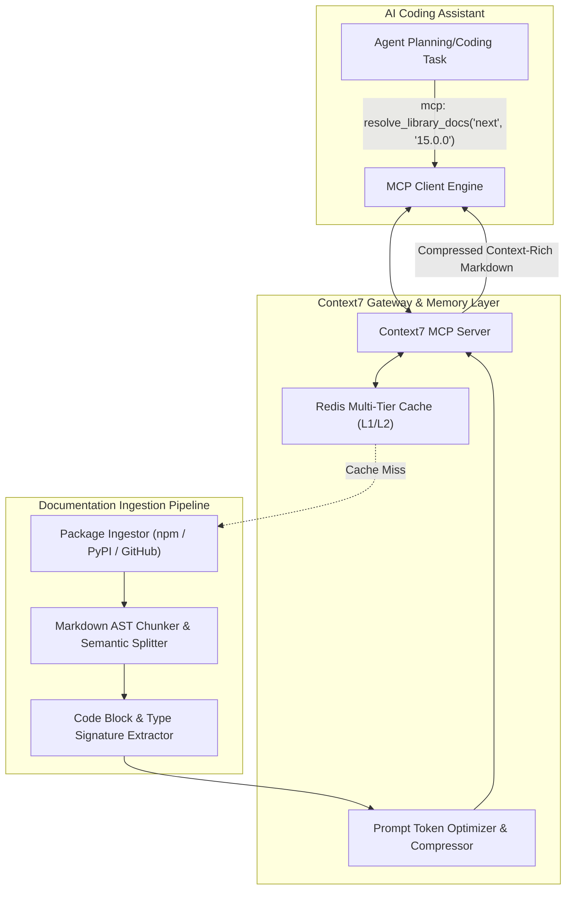

# Context7 Architecture & Feature Reverse Engineering
**Reference URL:** `https://context7.com`  
**REA Evidence ID:** `ev_642f0aab2b3baec7836ac55d2ea24442201cbb5e1c5aa6e0937c4f4cd35cbc61`

---

## 1. System Overview

Context7 solves the **LLM Knowledge Cutoff & Hallucination Problem** for modern software libraries. Large Language Models frequently generate deprecated code for rapidly changing open-source frameworks (e.g. Next.js 14 $\to$ 15, React 18 $\to$ 19, Pydantic v1 $\to$ v2, LangChain 0.1 $\to$ 0.3).

Context7 acts as a high-speed, version-aware documentation index and delivery layer for AI coding agents (Claude Code, Cursor, Windsurf, Antigravity) via the Model Context Protocol (MCP).

---

## 2. Reconstructed Architectural Topology

---

## 3. Core Engine Components

### 3.1 Version-Aware Ingestor (`doc-scraper.ts`)
- Resolves package coordinates (`package_name`, `version`, `language`).
- Fetches authoritative documentation from GitHub repositories, READMEs, and package manifests.
- Flags breaking changes between major versions.

### 3.2 Code Block & Type Signature Extractor (`code-extractor.ts`)
- Scans documentation markdown AST for fenced code blocks.
- Identifies imported modules, export signatures, and runtime environment (Node.js, Browser, Edge).
- Discards non-executable pseudocode to preserve agent accuracy.

### 3.3 Token Budget Optimizer (`token-optimizer.ts`)
- Agent context windows are finite and costly. Context7 applies a multi-step compression pipeline:
  1. Strips marketing fluff, badges, and redundant prose.
  2. Preserves all type signatures, function contracts, parameters, and return types.
  3. Formats code examples with minimal comments.
  4. Delivers dense, information-rich documentation within a strict token budget (e.g. 1,500 - 3,000 tokens).

### 3.4 MCP Server Interface
- **`resolve_library_docs`**: Fetch canonical docs for a package at a specific version.
- **`get_code_examples`**: Return verified, runnable code snippets for a given feature.
- **`search_package_api`**: Search function signatures and method contracts.
