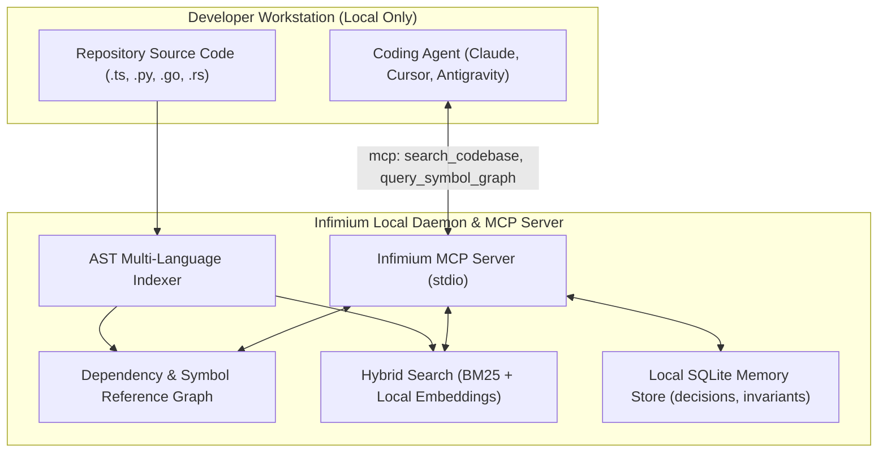

# Infimium Architecture & Feature Reverse Engineering
**Reference URL:** `https://infimium.com`  
**REA Evidence ID:** `ev_88a6222c1011032cff961e71abb83605a0bdd9e181cca467c38293b9d04ae42b`

---

## 1. System Overview

Infimium is a **local-first, privacy-guaranteed repository intelligence layer** and Model Context Protocol (MCP) server.

Unlike cloud-dependent code assistants that stream proprietary source code to external servers for indexing, Infimium performs:
1. **Local AST Parsing & Symbol Indexing**: Extracts classes, functions, interfaces, and exports directly on the developer's workstation.
2. **Deterministic Cross-File Dependency Graphs**: Resolves import paths and maps caller/callee relationships without external network calls.
3. **Hybrid Lexical & Semantic Retrieval**: Blends fast BM25 keyword matching with local vector embeddings.
4. **Persistent Project Memory**: Stores architectural decisions, repository conventions, and plan state in a local SQLite database that persists across agent conversations.

---

## 2. Reconstructed Architectural Topology

---

## 3. Core Feature Deconstruction

### 3.1 Multi-Language AST Indexer (`indexer.ts`)
- Recursively walks repository files while respecting `.gitignore`.
- Extracts:
  - **Symbol Declarations**: Name, kind (`function`, `class`, `interface`, `type`, `variable`), start line, end line, docstrings.
  - **Imports & Exports**: Default, named, namespace imports, dynamic imports.
- Computes SHA-256 file digests for incremental re-indexing.

### 3.2 Dependency & Symbol Graph (`graph.ts`)
- Builds a directed graph $G = (V, E)$:
  - Vertices $V$: Files and top-level exported symbols.
  - Edges $E$: Directed import, invocation, or inheritance links.
- Supports graph queries:
  - `get_callees(symbolId)`: Find all functions called by this symbol.
  - `get_callers(symbolId)`: Find all usages/callers across the codebase.
  - `detect_circular_dependencies()`: Identifies import cycles.

### 3.3 Hybrid Search Engine (`search.ts`)
- **BM25 Lexical Scoring**: Evaluates exact term frequency and inverse document frequency across symbol identifiers and comments.
- **Cosine Similarity Semantic Scoring**: Evaluates dense semantic embeddings for conceptual questions (e.g. "where is authentication handled?").
- **Reciprocal Rank Fusion (RRF)**:
  $$\text{RRF}(d) = \sum_{m \in \{\text{BM25}, \text{Semantic}\}} \frac{1}{k + r_m(d)}$$
  Ensures high accuracy whether searching for an exact variable name or a high-level concept.

### 3.4 Persistent Project Memory (`memory.ts`)
- Manages an embedded SQLite database storing:
  - **Architectural Decision Records (ADRs)**: Why specific libraries or designs were chosen.
  - **Codebase Invariants**: Rules agents must follow (e.g., "always use server actions for mutations", "strict null checks enforced").
  - **Task Checkpoints**: Session states and planned milestones.
