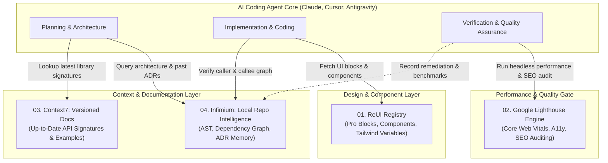

# Unified Autonomous AI Software Engineering Architecture
**Orchestration Blueprint:** ReUI + Google Lighthouse + Context7 + Infimium

---

## 1. Architectural Synergy

When deployed together, these four reverse-engineered systems create a closed-loop, self-verifying autonomous software development lifecycle for AI coding agents:

---

## 2. End-to-End Agent Execution Flow

1. **Reconnaissance & Memory Retrieval (Infimium)**:
   - Agent receives user prompt (e.g. "Add a real-time analytics dashboard with revenue charts").
   - Agent calls `infimium:read_project_memory` to check design constraints and invariants.
   - Agent calls `infimium:search_codebase` to identify where routes, auth session, and database models are defined.

2. **Up-to-Date Library Contract Verification (Context7)**:
   - If the project uses Next.js 15, Recharts 2.12+, or React 19, the agent calls `context7:resolve_library_docs` and `context7:get_code_examples`.
   - Prevents hallucinations of deprecated parameters or synchronous APIs.

3. **Component Injection & Scaffolding (ReUI)**:
   - Agent calls `reui:search_components(query: 'analytics')`.
   - Agent pulls the `analytics-chart-block` or `data-grid` source code via `reui:get_component`.
   - Agent injects the code into the repository and runs `npx shadcn add` with exact dependencies.

4. **Continuous Quality Gate & Remediation (Google Lighthouse)**:
   - Agent deploys a local dev preview or staging container.
   - Agent triggers `lighthouse:run_lighthouse_audit` to evaluate FCP, LCP, CLS, TBT, and SEO.
   - If any metric scores below 0.90, the agent executes `lighthouse:get_performance_remediation` and optimizes the component (e.g. preloading hero images, setting explicit dimensions, splitting bundles).
   - Once benchmarks pass, agent records the decision in `infimium:record_project_decision`.
