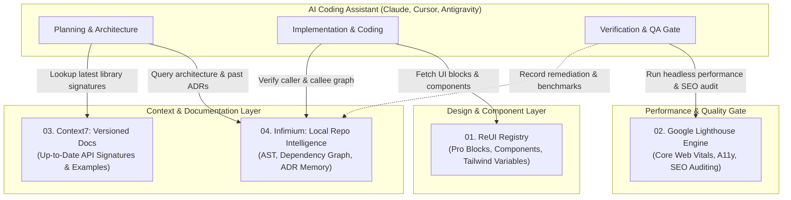

# REA Developer Ecosystem (`rea-developer-ecosystem`)
**Reverse-Engineered Autonomous AI Engineering Suite**  
*Reconstructed with REA (Reverse Engineer Anything, v6.7.0 — `morluto/rea`)*

[](LICENSE)
[](https://github.com/morluto/rea)
[](https://modelcontextprotocol.io)
[](05_UNIFIED_DEPLOYMENT_AND_RUNBOOK/docker-compose.all.yml)

---

## 🌟 Overview

This repository contains the complete reverse engineering, architectural reconstruction, and production deployment blueprints for four core platforms powering modern web development and AI coding agents:

1. **[ReUI](https://reui.io)** — Advanced UI component library, Pro Blocks, and Shadcn/Tailwind registry protocol.
2. **[Google Lighthouse](https://developer.chrome.com/docs/lighthouse/overview)** — Chrome DevTools Protocol automated performance, accessibility, SEO, and Core Web Vitals auditing engine.
3. **[Context7](https://context7.com)** — Version-aware documentation extractor, AST code snippet verifier, and prompt token budget compressor for LLMs.
4. **[Infimium](https://infimium.com)** — Local-first, zero-cloud repository intelligence layer, AST symbol graph, hybrid BM25 retrieval, and persistent project memory.
5. **[Universal SEO Agent Suite](06_UNIVERSAL_SEO_AGENT_SUITE)** — Tri-platform (Antigravity, Codex, Claude Code) multi-agent SEO & Generative Engine Optimization (GEO) audit suite reverse-engineered from `AgriciDaniel/claude-seo`.

Every system has been analyzed using **REA's Evidence-First methodology** and reconstructed into clean, self-hostable microservices and **Model Context Protocol (MCP)** servers ready for immediate integration with AI coding assistants (Claude Code, Cursor, Windsurf, Antigravity).

---

## 💡 Practical Use Cases

### 1. Autonomous End-to-End Feature Development
- **The Problem:** AI agents often build disconnected, unstyled, or hallucinated code that fails modern standards.
- **The Solution:**
  1. **Infimium** queries local ASTs and past Architectural Decision Records (ADRs) to understand existing codebase patterns.
  2. **Context7** feeds the agent exact, version-accurate documentation (e.g. Next.js 15 async headers, React 19 Actions) to eliminate deprecation errors.
  3. **ReUI** provides pre-built, accessible Tailwind/Shadcn Pro Blocks (virtualized data grids, responsive charts, checkout flows).
  4. **Google Lighthouse** automatically audits the generated view for Core Web Vitals (LCP, CLS, TBT) and SEO before deployment.

### 2. Private, Zero-Cloud Enterprise Code Intelligence
- **The Problem:** Enterprises cannot send proprietary source code or intellectual property to third-party cloud embedding providers.
- **The Solution:**
  - Run **Infimium** locally as an MCP server. It indexes multi-language symbols (TypeScript, Python, Go, Rust), resolves directed call graphs, and stores project invariants in a local SQLite database without any external network egress.

### 3. Automated Performance & Accessibility CI/CD Gate
- **The Problem:** Regressions in page load speed and accessibility slip into production unnoticed.
- **The Solution:**
  - Use the reverse-engineered **Google Lighthouse Engine** with its exact log-normal distribution scoring curves ($p_{10}$, $median$) inside your CI pipeline or Docker cluster to evaluate staging previews on every pull request.

### 4. Self-Hosted Shadcn/UI Component Registry
- **The Problem:** Teams wanting reusable enterprise UI blocks are either locked into proprietary platforms or have to manually copy-paste code across dozens of repositories.
- **The Solution:**
  - Deploy the **ReUI Component Registry** (`/r/[name].json`) to self-host custom components. Developers install them in one standard command: `npx shadcn@latest add http://your-registry:3001/r/data-grid.json`.

---

## 🏛️ System Architecture



---

## 🔬 REA Evidence Register

All targets were captured via bounded Chromium CDP scenarios (`rea-playwright-browser-scenario`):

| Target | URL | Evidence ID | Retained Artifacts |
| :--- | :--- | :--- | :--- |
| **ReUI** | `https://reui.io/` | `ev_46bf21a02fad9134ce8552167d7cc4fa73dff369429130cf51d424e3b6d88077` | DOM (1.75 MB), Tokens, Storage, Network |
| **Lighthouse** | `https://developer.chrome.com/docs/lighthouse/overview` | `ev_eb63da7ac8d12a1f6fe6d441e8542ad599655ce97f55e672da11f2f18ee823d5` | DOM (172 KB), Protocol Invariants, Curves |
| **Context7** | `https://context7.com/` | `ev_642f0aab2b3baec7836ac55d2ea24442201cbb5e1c5aa6e0937c4f4cd35cbc61` | DOM (218 KB), Hydration Chunks, Tools |
| **Infimium** | `https://infimium.com/` | `ev_88a6222c1011032cff961e71abb83605a0bdd9e181cca467c38293b9d04ae42b` | DOM (194 KB), SPA Bundle, Memory Contracts |

---

## 📁 Repository Structure

```
├── 00_EXECUTIVE_SUMMARY_AND_METHODOLOGY.md   # Complete REA methodology and evidence register
├── 01_REUI_COMPONENT_REGISTRY/              # ReUI Component Registry & MCP Server
│   ├── ARCHITECTURE_AND_FEATURES.md
│   ├── REA_EVIDENCE_AND_OBLIGATION_LEDGER.md
│   ├── schema/                              # JSON Schemas (registry-item, registry-index)
│   ├── mcp-server/                          # Standalone TypeScript MCP Server
│   ├── cli-engine/                          # Component scanner & registry compiler
│   └── deployment/                          # Dockerfile & Docker Compose
├── 02_GOOGLE_LIGHTHOUSE_ENGINE/             # Google Lighthouse Audit Runner & Scorer
│   ├── ARCHITECTURE_AND_FEATURES.md
│   ├── REA_EVIDENCE_AND_OBLIGATION_LEDGER.md
│   ├── core-engine/                         # Log-normal scoring math, runner & audits
│   ├── mcp-server/                          # Lighthouse MCP Server
│   └── deployment/                          # Headless Chromium cluster deployment
├── 03_CONTEXT7_DOCS_INTELLIGENCE/           # Context7 Versioned Documentation Engine
│   ├── ARCHITECTURE_AND_FEATURES.md
│   ├── REA_EVIDENCE_AND_OBLIGATION_LEDGER.md
│   ├── engine/                              # Scraper, code extractor, token optimizer
│   ├── mcp-server/                          # Context7 MCP Server
│   └── deployment/                          # Redis cache & scraper deployment
├── 04_INFIMIUM_LOCAL_REPO_INTELLIGENCE/     # Infimium Local-First Codebase Engine
│   ├── ARCHITECTURE_AND_FEATURES.md
│   ├── REA_EVIDENCE_AND_OBLIGATION_LEDGER.md
│   ├── engine/                              # Multi-lang AST indexer, graph, BM25, memory
│   ├── mcp-server/                          # Infimium MCP Server
│   └── deployment/                          # Local daemon container setup
└── 05_UNIFIED_DEPLOYMENT_AND_RUNBOOK/       # Unified Mesh Orchestration
    ├── UNIFIED_SYSTEM_ARCHITECTURE.md
    ├── docker-compose.all.yml
    ├── .env.example
    └── DEPLOYMENT_RUNBOOK.md
```

---

## 🚀 Quickstart: Launching the Stack

### 1-Click Launch with Docker Compose
```bash
cd 05_UNIFIED_DEPLOYMENT_AND_RUNBOOK
cp .env.example .env
docker compose -f docker-compose.all.yml up -d
```

### Connect to AI Coding Assistants (MCP Configuration)
Add to your client configuration file (e.g. `claude_desktop_config.json`, `.cursor/mcp.json`, or Antigravity's `mcp_config.json`):

```json
{
  "mcpServers": {
    "reui": {
      "command": "node",
      "args": ["<PATH_TO_REPO>/01_REUI_COMPONENT_REGISTRY/mcp-server/dist/index.js"]
    },
    "lighthouse": {
      "command": "node",
      "args": ["<PATH_TO_REPO>/02_GOOGLE_LIGHTHOUSE_ENGINE/mcp-server/dist/index.js"]
    },
    "context7": {
      "command": "node",
      "args": ["<PATH_TO_REPO>/03_CONTEXT7_DOCS_INTELLIGENCE/mcp-server/dist/index.js"]
    },
    "infimium": {
      "command": "node",
      "args": ["<PATH_TO_REPO>/04_INFIMIUM_LOCAL_REPO_INTELLIGENCE/mcp-server/dist/index.js"]
    }
  }
}
```

---

## 📜 License
MIT License. Created for advanced agentic software engineering and research.
